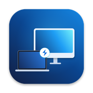
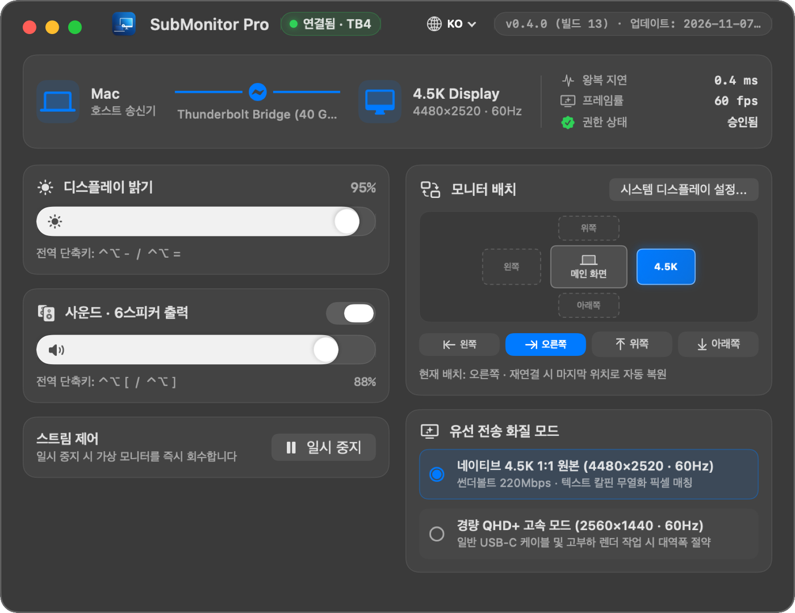
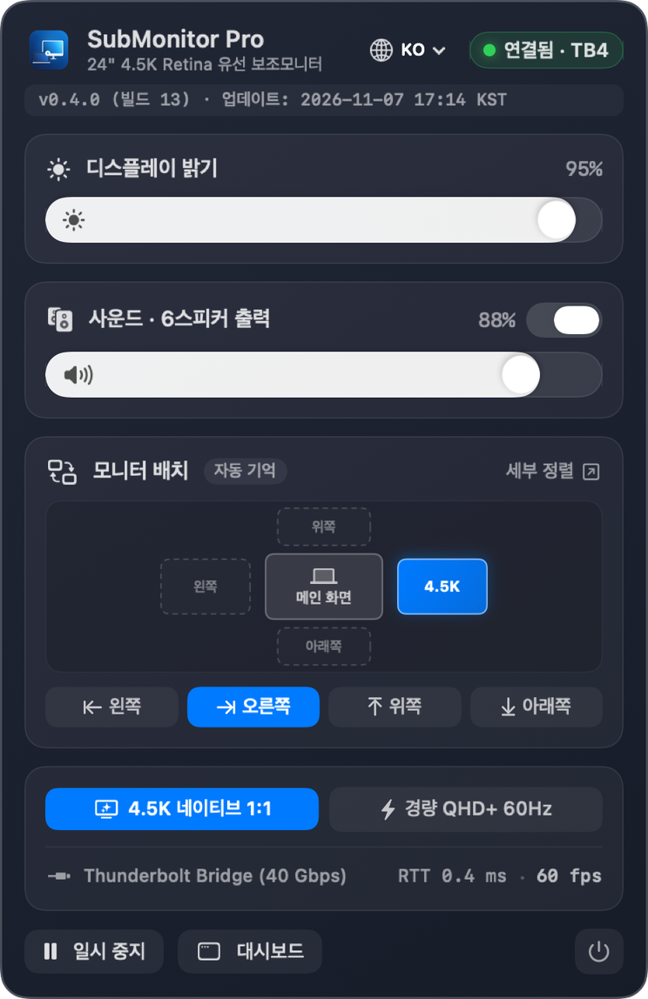

  

<h1 align="center">SubMonitor Pro (macOS)</h1>

  <strong>집에서 놀고 있는 24인치 Apple Silicon 아이맥을 케이블 1선으로 4.5K 60Hz 유선 모니터로 연결합니다.</strong> 
  <a href="https://videofactories.com/submonitor/?lang=ko&ref=github"><strong>무료 베타 테스터 우선 신청 (KO) ↗</strong></a> ·
  <a href="./README.md">English README</a>

---

## 소개

전원이 꺼진 채 방치된 24인치 Apple Silicon 아이맥을 맥북용 **4.5K 60Hz 유선 보조모니터**로 연결해 주는 네이티브 macOS 유틸리티 **SubMonitor Pro (`v0.4.0`, 빌드 `13`)** 공식 안내 저장소입니다.

- **18.5초 실제 앱 구동 영상 및 무료 베타 신청:** [https://videofactories.com/submonitor/?lang=ko&ref=github](https://videofactories.com/submonitor/?lang=ko&ref=github)
- **한국어 데모 영상 바로 보기 (MP4):** [demo-ko.mp4](https://videofactories.com/submonitor/assets/demo-ko.mp4)

---

## 프로그램 창 핵심 기능

1. **썬더볼트 · USB-C 케이블 1선 직결**: 인터넷·와이파이 없이 오프라인 IPv6 링크 로컬 통신(왕복 지연 약 `0.4ms`)으로 즉시 연결됩니다.
2. **듀얼 해상도 모드**: 텍스트 가독성을 살리는 **4.5K 네이티브 1:1 (`4480×2520 @ 60Hz`)** 및 대역폭을 아끼는 **경량 QHD+ (`2560×1440 @ 60Hz`)** 고속 모드를 지원합니다.
3. **단일 네이티브 제어 창 (상단바 팝오버 & 대시보드)**:
   - 아이맥 디스플레이 밝기 슬라이더 및 전역 단축키 (`⌃⌥-` / `⌃⌥=`)
   - 아이맥 내장 **6스피커 48kHz PCM** 사운드 출력 토글 및 볼륨 조절
   - 상·하·좌·우 모니터 배치 원클릭 설정 및 재연결 시 위치 자동 복원
4. **macOS 잠자기 자동 절전 연동**: 호스트 맥이 macOS 잠자기 또는 화면 절전으로 전환되면 아이맥 화면도 자동으로 암전 대기 모드로 들어가고 깨울 때 자동 복귀합니다.
5. **가격 안내**: `$89.99` 외장 하드웨어 동글 불필요 · 정기 구독료 `$0` · 정식 출시 예정가 **일회성 `$29 USD` 평생 라이선스** (현재 무료 베타 모집 중)

  

