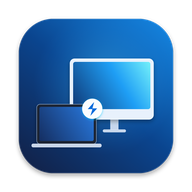
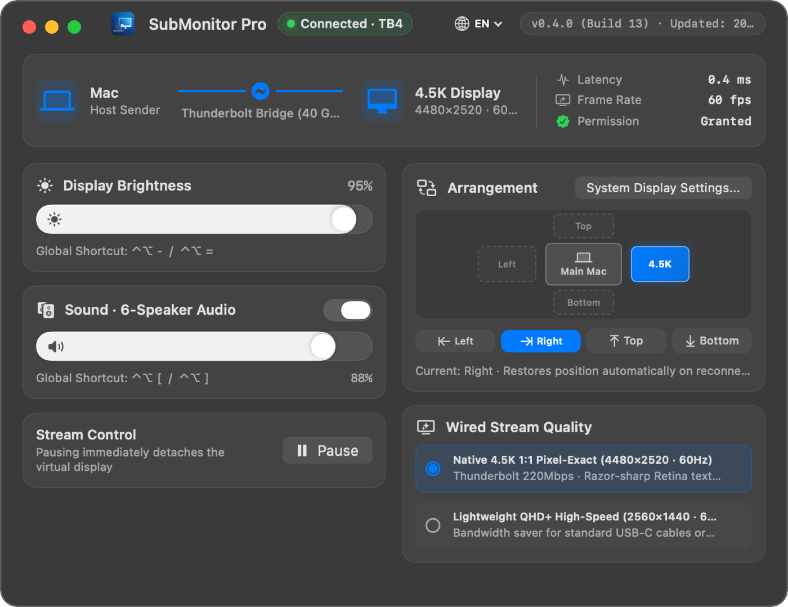
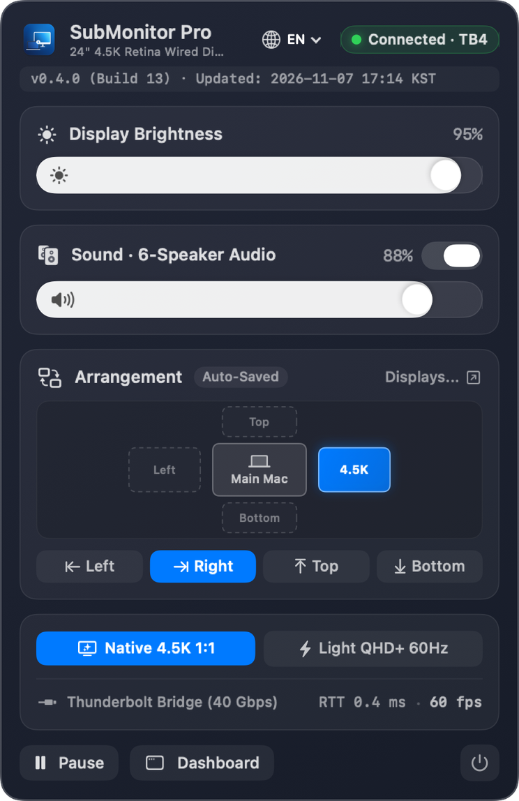

  

<h1 align="center">SubMonitor Pro (macOS)</h1>

  <strong>Turn an unused 24-inch Apple Silicon iMac into a native 4.5K 60Hz wired monitor over 1 cable.</strong> 
  <a href="https://videofactories.com/submonitor/?lang=en&ref=github"><strong>Join the Free Beta Waitlist (EN) ↗</strong></a> ·
  <a href="https://videofactories.com/submonitor/?lang=ko&ref=github"><strong>무료 베타 신청 (한국어) ↗</strong></a> ·
  <a href="./README.ko.md">한국어 안내</a>

---

## Overview

Apple discontinued hardware Target Display Mode on modern iMacs—leaving owners of unused 24-inch Apple Silicon iMacs to choose between wireless AirPlay lag, `$89.99` hardware dongles, or `$36–$72/yr` recurring subscriptions.

**SubMonitor Pro (`v0.4.0`, Build `13`)** is a lightweight native Swift + AppKit/SwiftUI utility for macOS `15.0+` (Sequoia) that connects your host MacBook / Mac to an idle 24-inch iMac over **a single Thunderbolt or USB-C cable**.

- **18.5-Second Demo Video & Free Beta Signup:** [https://videofactories.com/submonitor/?lang=en&ref=github](https://videofactories.com/submonitor/?lang=en&ref=github)
- **Direct 18.5s MP4 Demo (Actual App Window):** [demo-en.mp4](https://videofactories.com/submonitor/assets/demo-en.mp4)

---

## Core Specifications & Single-Window Controls

1. **Single-Cable Offline Link (`~0.4 ms` RTT)**
   - Communicates over Thunderbolt / USB-C offline IPv6 link-local networking—zero Wi-Fi lag and no internet connection required.
2. **Dual Wired Display Modes**
   - **Native 4.5K 1:1 (`4480×2520 @ 60Hz`)** for pixel-exact Retina text and code.
   - **Lightweight QHD+ (`2560×1440 @ 60Hz`)** to save bandwidth on standard USB-C cables.
3. **One Native Control Window (Menu Bar Popover & Dashboard)**
   - **Display Brightness:** Smooth slider + global keyboard shortcuts (`⌃⌥-` / `⌃⌥=`).
   - **6-Speaker 48kHz PCM Audio:** Toggle and control the iMac's built-in 6-speaker woofer sound system directly from your MacBook.
   - **Interactive Arrangement Map:** Place the iMac Left, Right, Top, or Bottom in one click—automatically restores its exact position on reconnect.
4. **Automatic macOS Sleep Sync**
   - Observes `NSWorkspace.willSleepNotification` and `screensDidSleepNotification` on your host Mac so the iMac panel enters dark standby automatically and wakes right back up with your Mac.
5. **8 Built-in Languages**
   - English, Korean (`한국어`), Japanese (`日本語`), Simplified & Traditional Chinese, German, Spanish, and French.

  

---

## Pricing & Free Beta Waitlist

| Feature | SubMonitor Pro | Luna Display | Duet Display |
| :--- | :--- | :--- | :--- |
| **Connection** | **1 Thunderbolt or USB-C Cable** | Hardware Dongle Required | Cable or Network Streaming |
| **Offline Latency** | **100% Offline IPv6 (`~0.4 ms` RTT)** | Varies by Wi-Fi / Cable | Varies by Network / Encoding |
| **Brightness & 6-Speaker** | **Integrated in 1 Native Window** | Device-dependent | Plan-dependent |
| **Pricing (USD)** | **$29 Planned Lifetime (`$0/mo`)** | `$89.99` + shipping | `$36–$72/yr` subscription |

> *Planned release price is a one-time **$29 USD** lifetime license with `$0` recurring subscription (finalized at beta exit). Free beta invites are open now:*
> **[https://videofactories.com/submonitor/?lang=en&ref=github](https://videofactories.com/submonitor/?lang=en&ref=github)**
